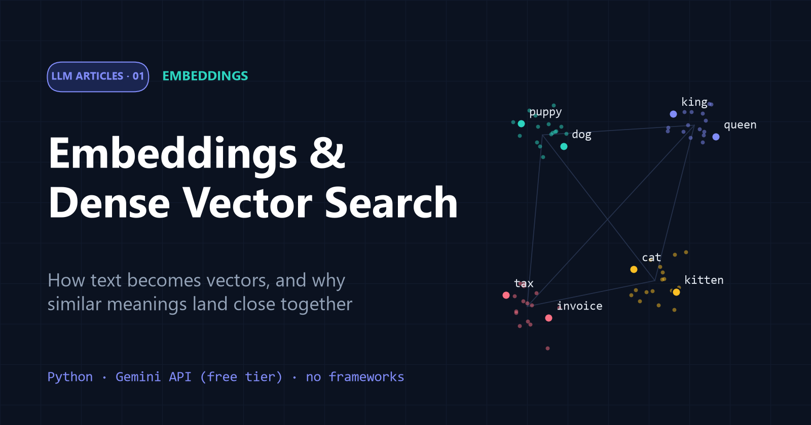

# 01 · Embeddings and Dense Vector Search

[](article.md)

How text becomes vectors, how cosine similarity measures meaning, and how a semantic search engine works, measured with Google's `gemini-embedding-001`.

| File | What it is |
| --- | --- |
| [article.md](article.md) | the full article |
| [embeddings.ipynb](embeddings.ipynb) | step-by-step notebook with explanations and real outputs |
| [embeddings.py](embeddings.py) | the same code as a single script |
| [assets/](assets/) | diagrams and charts used in the article |

## What the notebook shows

1. Cosine similarity on toy vectors
2. Turning sentences into 3,072-number vectors
3. A fair comparison that changes one thing at a time (*"I love puppies!"* vs. dogs, cats, dislike…)
4. *king − man + woman*: *queen* ranks first, but doesn't beat the *king*-vs-*queen* baseline
5. A tiny semantic search engine
6. Shorter 768-number vectors, and why they need normalizing

## Run it

From the repository root (see the [main README](../README.md) for setup):

```bash
jupyter notebook 01-Embeddings/embeddings.ipynb
# or
python 01-Embeddings/embeddings.py
```

A full run makes 6 embedding requests.

**Next:** [02 · RAG from Scratch](../02-RAG/)
