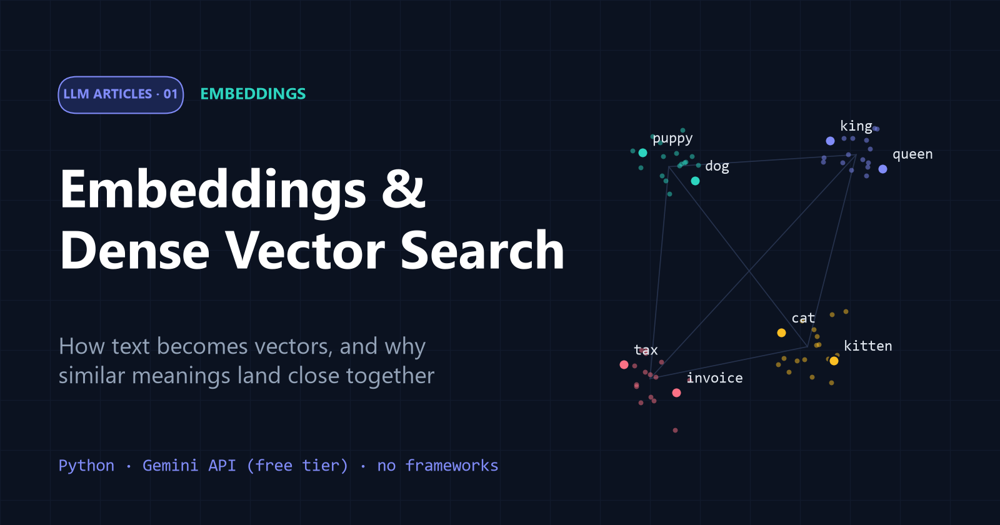
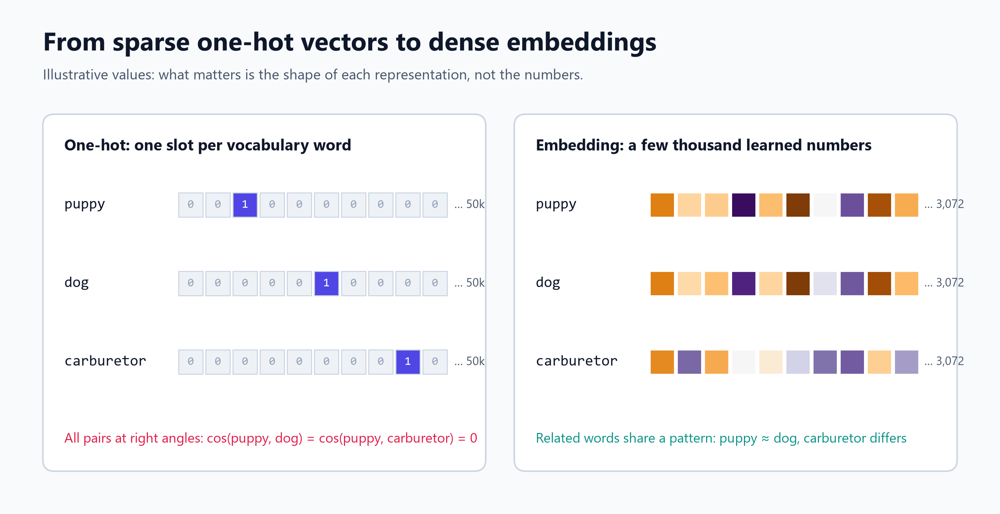
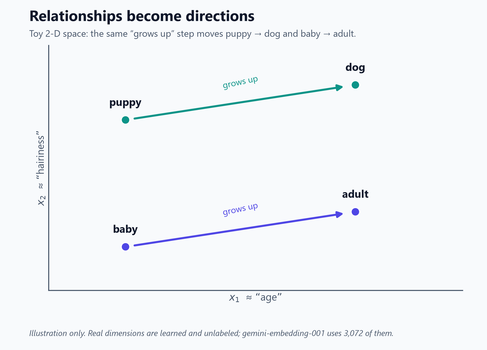
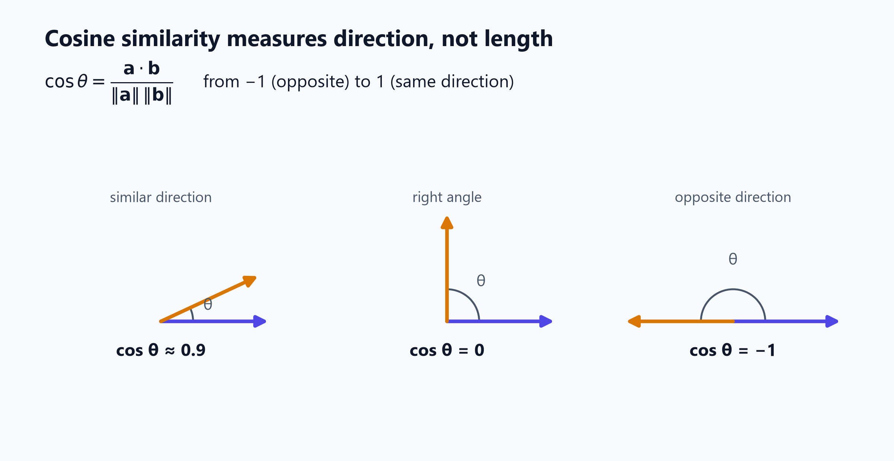
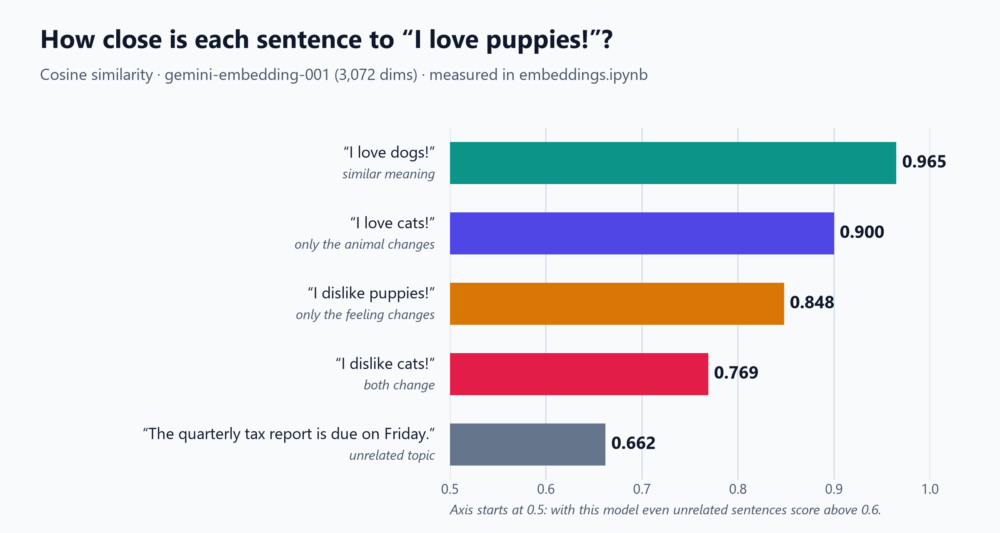
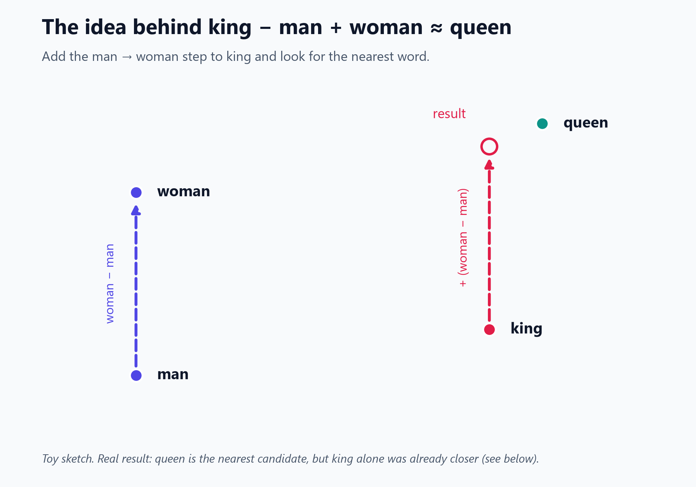
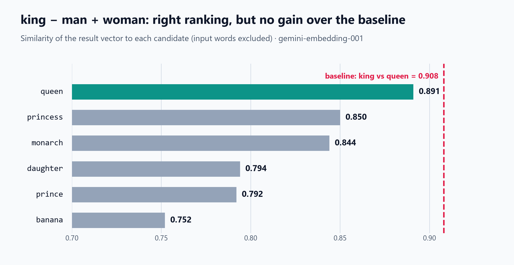
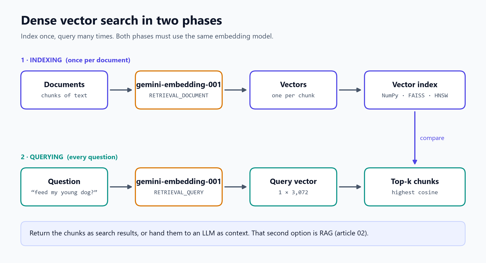

# Embeddings and Dense Vector Search: A Practical Primer



*Part 1 of the [LLM Articles](../README.md) series · Code: [`embeddings.ipynb`](embeddings.ipynb) · Runs on the free tier of the Gemini API*

If you come from an NLP background, embeddings are probably old friends. If not, the topic can feel a bit… *dense*. (That joke makes more sense by the end of the article.)

Embeddings are the quiet workhorse behind semantic search, recommendations, clustering and retrieval-augmented generation (RAG). They turn text into lists of numbers in which **distance tracks meaning**.

This primer builds the idea from first principles. It implements the core math in a few lines of NumPy, measures real results with Google's `gemini-embedding-001` model, and ends with a working **dense vector search**. Along the way it tests the popular claims about embeddings against actual numbers, and one famous claim doesn't hold up as well as you might expect.

**What you will learn**

- Why machine learning needs embeddings, and why one-hot encoding is not enough
- What an embedding is, and how geometry captures meaning
- How cosine similarity works, and how to read its scores without fooling yourself
- What *king − man + woman ≈ queen* does and does not show, with a proper baseline
- How to build a tiny semantic search engine, and how it scales

**Prerequisites:** basic Python. To run the code you need a free Gemini API key from [Google AI Studio](https://aistudio.google.com/apikey).

---

## Table of contents

1. [Why do we need embeddings?](#1-why-do-we-need-embeddings)
2. [What is an embedding?](#2-what-is-an-embedding)
3. [Measuring closeness with cosine similarity](#3-measuring-closeness-with-cosine-similarity)
4. [Hands-on: comparing sentences with Gemini](#4-hands-on-comparing-sentences-with-gemini)
5. [Vector arithmetic: king − man + woman ≈ queen?](#5-vector-arithmetic-king--man--woman--queen)
6. [From similarity to dense vector search](#6-from-similarity-to-dense-vector-search)
7. [Where embeddings are used](#7-where-embeddings-are-used)
8. [Limitations and pitfalls](#8-limitations-and-pitfalls)
9. [Key takeaways](#9-key-takeaways)
10. [References](#references)

---

## 1. Why do we need embeddings?

Every machine learning model, from logistic regression to a large language model, has one thing in common: **it only accepts numbers**. People communicate in words, images and sound, so we need a way to translate our world into the machine's.

A useful translation has to do two jobs:

1. **Turn non-numeric data into numbers.**
2. **Keep the relationships between meanings**, so that related inputs get related numbers. An algorithm should be able to tell that *puppy* and *dog* have something in common.

### The naive approach: one-hot vectors

The simplest way to turn words into numbers is **one-hot encoding**. Give every word in the vocabulary its own position in a vector, put a `1` there, and put `0` everywhere else. With a 50,000-word vocabulary, every word becomes a 50,000-long vector with a single `1`.

That handles job 1 and fails job 2 completely:

- **Every word is equally unrelated to every other word.** Any two one-hot vectors are at right angles to each other (*orthogonal*), so *puppy* is exactly as far from *dog* as from *carburetor*.
- **The vectors are huge and almost entirely zeros.** Vectors like this are called *sparse*.



**Embeddings** fix both problems. They are *dense*: nearly every entry is a non-zero real number. They are also far shorter, a few hundred to a few thousand numbers (`gemini-embedding-001` uses 3,072). The values are *learned* so that similar inputs get similar vectors. That is the "dense" in *dense vector search*, and the reason for the pun in the introduction.

---

## 2. What is an embedding?

> **Embedding:** a learned mapping from an input (a word, sentence, document, image…) to a fixed-length list of real numbers, arranged so that inputs with similar meanings land at nearby points.

You can think of each number as measuring some hidden property of the input, a *latent feature*, that the model discovered during training. A classic toy picture makes this concrete. Imagine a space with only two dimensions, where $x_1$ roughly tracks "age" and $x_2$ roughly tracks "hairiness":



- *puppy → dog* and *baby → adult* point the **same way**: both mean "grows up".
- Dogs are hairier than people, so the dog pair sits higher on $x_2$.
- Adults have more hair than babies, so *adult* sits a little higher than *baby*.

The key insight is that **relationships become directions**. Taking the same step from different starting points applies the same change in meaning.

Real embeddings are not this tidy. Their dimensions are **not labelled** and can't be read one at a time. No single number means "age", and meaning is spread across thousands of dimensions at once. The toy picture is still the right *mental model*.

### Where do embeddings come from?

Embedding models learn from huge amounts of text, guided by the **distributional hypothesis**: words that appear in similar contexts tend to mean similar things.

- **Word embeddings** such as word2vec [3] learn one vector per word by predicting each word's neighbours in large text collections.
- **Sentence and document embeddings**, such as Sentence-BERT [5] and modern API models like `gemini-embedding-001` [1], use transformer networks. They are usually trained *contrastively*: matching pairs, such as a question and its answer, are pulled together, and unrelated pairs are pushed apart.

Our examples use a modern sentence-level model. It embeds single words without complaint, but it was built for passages. That detail matters in Section 5.

---

## 3. Measuring closeness with cosine similarity

If similar meanings map to nearby vectors, we need a way to measure "nearby". The standard choice for embeddings is **cosine similarity**, the cosine of the angle $\theta$ between two vectors:

$$
\cos\theta = \frac{\mathbf{a} \cdot \mathbf{b}}{\lVert \mathbf{a} \rVert \, \lVert \mathbf{b} \rVert}
$$

The top, $\mathbf{a} \cdot \mathbf{b}$, is the **dot product**: multiply matching entries and add them up. The bottom divides by both vectors' **lengths**. That division is what makes cosine similarity care only about **direction**, not size.



| Score | Geometric meaning |
| --- | --- |
| `1` | same direction |
| `0` | at right angles: nothing in common |
| `−1` | exactly opposite directions |

### Implementation

```python
import numpy as np

def cosine_similarity(a, b) -> float:
    """Cosine of the angle between two vectors: 1 = same direction, 0 = unrelated, -1 = opposite."""
    a, b = np.asarray(a, dtype=float), np.asarray(b, dtype=float)
    return float(a @ b / (np.linalg.norm(a) * np.linalg.norm(b)))
```

A quick check on toy vectors (real output from the notebook):

```python
a = [1, 2, 3]
cosine_similarity(a, [2, 4, 6])     # 1.0     same direction, twice as long
cosine_similarity(a, [3, 0, -1])    # 0.0     at right angles
cosine_similarity(a, [-1, -2, -3])  # -1.0    opposite direction
cosine_similarity(a, [3, 2, 1])     # 0.7143  partly aligned
```

`[2, 4, 6]` scores a perfect `1.0` although it is twice as long as `a`: length doesn't count.

### A shortcut for unit-length vectors

If both vectors have length 1, the bottom of the formula is 1, and **cosine similarity is just the dot product**. Full-size (3,072-number) vectors from `gemini-embedding-001` have length 1, which the notebook confirms (`length (L2): 1.0`). Shortened vectors do not (see Section 6), so normalize them before relying on this shortcut.

---

## 4. Hands-on: comparing sentences with Gemini

### Setup

```bash
pip install google-genai numpy python-dotenv
```

Put your key in a `.env` file (`GEMINI_API_KEY=...`) rather than in your code. The notebook loads it automatically and asks for it if it's missing.

```python
import os
import numpy as np
from dotenv import load_dotenv
from google import genai
from google.genai import types

load_dotenv()
client = genai.Client(
    api_key=os.environ["GEMINI_API_KEY"],
    # retry automatically if the free-tier rate limit is hit
    http_options=types.HttpOptions(retry_options=types.HttpRetryOptions(attempts=5, initial_delay=2.0)),
)

def embed(texts, task_type="SEMANTIC_SIMILARITY") -> np.ndarray:
    """Return one embedding per text, as an array of shape (len(texts), 3072)."""
    response = client.models.embed_content(
        model="gemini-embedding-001",
        contents=list(texts),
        config=types.EmbedContentConfig(task_type=task_type),
    )
    return np.array([e.values for e in response.embeddings])
```

Two details are worth noticing:

- **Batching.** `embed_content` takes a *list* and returns one vector per item, so one request can embed many texts. That matters on the free tier, where limits are counted in requests.
- **`task_type`.** This tells the model how the vectors will be used. `SEMANTIC_SIMILARITY` is for comparing texts with each other. For search, use `RETRIEVAL_DOCUMENT` for stored texts and `RETRIEVAL_QUERY` for questions [1].

### A fair experiment

The classic demo compares *"I love puppies!"* with *"I love dogs!"* and then with *"I dislike cats!"*. That second sentence changes **two things at once**: the feeling and the animal. To see which change matters, we also change **one thing at a time**, and we add an unrelated sentence as a floor.

```python
sentences = [
    "I love puppies!",       # reference
    "I love dogs!",          # similar meaning
    "I dislike cats!",       # different feeling AND different animal
    "I love cats!",          # only the animal changes
    "I dislike puppies!",    # only the feeling changes
    "The quarterly tax report is due on Friday.",  # unrelated topic
]
vectors = embed(sentences)  # one request for all six
```



| Compared with "I love puppies!" | What changes | Cosine similarity |
| --- | --- | --- |
| "I love dogs!" | near-synonym | **0.965** |
| "I love cats!" | only the animal | **0.900** |
| "I dislike puppies!" | only the feeling | **0.848** |
| "I dislike cats!" | both | **0.769** |
| "The quarterly tax report is due on Friday." | everything | **0.662** |

What these real numbers teach us:

1. **The ranking matches intuition.** Near-synonyms score highest, and the unrelated sentence scores lowest.
2. **Opposite sentiment is not an opposite vector.** *"I dislike puppies!"* still scores 0.848. The sentence is about the same thing, puppies and how someone feels about them, and embeddings capture topic more strongly than polarity. A score of −1 does not mean "opposite meaning".
3. **Scores live in a narrow band.** Even a sentence about tax reports scores 0.662. Modern embedding models tend to place everything in a fairly narrow cone, so absolute values are far from the theoretical −1 to 1 range. This is sometimes called *anisotropy* [7].
4. **There is no universal "similar" threshold.** "0.8 means similar" might be true for one model and false for another. **Rank** results, or calibrate a cutoff on your own labelled data.

---

## 5. Vector arithmetic: king − man + woman ≈ queen?

The most famous embedding demo says that relationships can be added and subtracted. If the step from *man* to *woman* is a consistent direction, adding it to *king* should land near *queen*:

$$
\vec{\text{king}} - \vec{\text{man}} + \vec{\text{woman}} \approx \vec{\text{queen}}
$$



A single similarity score can't prove this, because *king* and *queen* are already closely related. A fair test needs two checks [3][4][8]:

1. **Ranking:** after leaving out the input words, is *queen* the closest candidate?
2. **Baseline:** is the result closer to *queen* than *king* itself was?

```python
words = ["king", "man", "woman", "queen", "princess", "prince", "monarch", "daughter", "banana"]
v = dict(zip(words, embed(words)))
result = v["king"] - v["man"] + v["woman"]

cosine_similarity(result, v["queen"])     # 0.891
cosine_similarity(v["king"], v["queen"])  # 0.908  <- baseline
```



**The ranking test passes.** *queen* (0.891) beats *princess* (0.850), *monarch* (0.844) and the rest, and *banana* comes last.

**The baseline test fails.** *king* on its own was already *closer* to *queen* (0.908) than the arithmetic result was. Subtracting *man* and adding *woman* kept us in the royalty neighbourhood without making the vector more queen-like.

That is not a bug in the code. The famous result comes from **word-level** models such as word2vec [3][4], trained to place individual words. Modern **sentence-level** models are optimized for whole passages, and research has also shown that the classic analogy test flattered itself by quietly excluding the input words [8]. The lasting lesson is still true: **relationships correspond to approximate directions**. But treat any single impressive demo with suspicion until it beats a baseline.

---

## 6. From similarity to dense vector search

The practical payoff of embeddings is **dense vector search**, also called *semantic search* or *dense retrieval*. Instead of matching keywords, you find stored texts whose embeddings point in the same direction as the question's.



1. **Indexing (once):** embed every document, or every chunk of a long document, with `task_type="RETRIEVAL_DOCUMENT"`, and store the vectors.
2. **Querying (each time):** embed the question with `task_type="RETRIEVAL_QUERY"` using the **same model**, compute its similarity to every stored vector, and return the top *k*.

### A tiny semantic search engine

```python
documents = [
    "Puppies need several small meals a day while they grow.",
    "Adult dogs are usually fed once or twice daily.",
    "Kittens sleep up to 20 hours a day.",
    "A carburetor mixes air and fuel for an internal combustion engine.",
    "The queen is the most powerful piece in chess.",
]
doc_vectors = embed(documents, task_type="RETRIEVAL_DOCUMENT")

def search(query: str, k: int = 3):
    query_vector = embed([query], task_type="RETRIEVAL_QUERY")[0]
    scores = [cosine_similarity(query_vector, d) for d in doc_vectors]
    best = np.argsort(scores)[::-1][:k]
    return [(scores[i], documents[i]) for i in best]

search("How often should I feed my young dog?")
```

Real output:

```text
0.757  Puppies need several small meals a day while they grow.
0.735  Adult dogs are usually fed once or twice daily.
0.581  Kittens sleep up to 20 hours a day.
```

The best match shares almost **no keywords** with the question ("feed" vs. "meals", "young dog" vs. "puppies"), yet it ranks first. Keyword search would struggle here; embeddings handle it easily.

### Smaller vectors for free

`gemini-embedding-001` is trained with **Matryoshka representation learning** [9]: the first dimensions carry the most information, so you can ask for shorter vectors with `output_dimensionality` and lose very little.

```python
config = types.EmbedContentConfig(task_type="SEMANTIC_SIMILARITY", output_dimensionality=768)
```

In the notebook, 768-dimensional vectors scored **0.964** for puppies vs. dogs, against **0.965** at full size, with a quarter of the storage. One catch: shortened vectors had length **0.587**, not 1, so **normalize them** before using a plain dot product.

### Scaling up

Comparing a question with every stored vector is fine for thousands of items, but slow for millions. Production systems use **approximate nearest neighbour (ANN)** indexes such as **HNSW** graphs [10] and **FAISS** [11]. They give up a tiny bit of accuracy for very large speed-ups. Vector databases wrap these indexes together with storage, filtering and updates.

Learned dense vectors can beat classic keyword search: Dense Passage Retrieval [6] was an influential early demonstration for open-domain question answering. Keyword search (BM25) is still useful, though. It wins on exact names, codes and rare jargon, so many systems run **hybrid search** that combines keyword and embedding scores.

When the top results are handed to a language model as context, dense vector search becomes the retrieval half of **retrieval-augmented generation (RAG)** [12]. That is the subject of [Part 2: RAG from Scratch](../02-RAG/article.md).

---

## 7. Where embeddings are used

- **Semantic search and question answering:** find passages by meaning, not keywords.
- **RAG:** give LLMs the right context from your own documents.
- **Recommendations:** suggest items whose embeddings are near the ones a user liked.
- **Clustering and topic discovery:** group tickets, reviews or papers by theme.
- **Deduplication:** detect near-duplicate questions or documents.
- **Classification:** use embeddings as features for a lightweight classifier.
- **Anomaly detection:** flag items that are far from every known cluster.
- **Multimodal search:** newer models embed text and images into one shared space, so a sentence can find a photo.

---

## 8. Limitations and pitfalls

- **Similar is not the same as true or relevant.** Embeddings capture *topic*. Our *"I dislike puppies!"* scored 0.848 against *"I love puppies!"*. Negation, numbers and fine logic are weak spots.
- **Dimensions are not interpretable,** which makes failures hard to debug.
- **Vectors from different models don't mix.** If you change models, re-embed everything.
- **Benchmarks are only a starting point.** Leaderboards like MTEB [13] compare models across many tasks, but always test on a sample of *your* real queries.
- **Inputs have a length limit** (2,048 tokens for `gemini-embedding-001`), and one vector for a long text blurs its details. Split long documents into chunks.
- **Learned bias.** Embeddings absorb associations from their training data, including stereotypes [14].
- **Quotas, cost and privacy.** Free-tier limits are counted per project and per model [2] (see your limits in [AI Studio](https://aistudio.google.com/rate-limit)), and an API call sends your text to a third party.

---

## 9. Key takeaways

- **Embeddings turn data into dense vectors in which direction encodes meaning.** Related inputs land close together.
- **Cosine similarity compares directions.** For unit-length vectors it is just a dot product.
- **Read scores relatively.** Modern models squeeze scores into a narrow band. Opposite sentiment still scores high, and there is no universal threshold.
- **Test claims fairly.** Change one variable at a time, and always compare against a baseline. With a modern model, *king − man + woman* ranks *queen* first but doesn't beat the baseline.
- **Dense vector search** means: embed the documents, embed the query, rank by similarity. It is the retrieval engine behind RAG.

---

## References

1. Google. *Embeddings* (Gemini API documentation). https://ai.google.dev/gemini-api/docs/embeddings
2. Google. *Gemini API rate limits.* https://ai.google.dev/gemini-api/docs/rate-limits
3. Mikolov, T., Chen, K., Corrado, G., & Dean, J. (2013). *Efficient Estimation of Word Representations in Vector Space.* arXiv:1301.3781. https://arxiv.org/abs/1301.3781
4. Mikolov, T., Yih, W., & Zweig, G. (2013). *Linguistic Regularities in Continuous Space Word Representations.* NAACL-HLT. https://aclanthology.org/N13-1090/
5. Reimers, N., & Gurevych, I. (2019). *Sentence-BERT: Sentence Embeddings using Siamese BERT-Networks.* arXiv:1908.10084. https://arxiv.org/abs/1908.10084
6. Karpukhin, V., et al. (2020). *Dense Passage Retrieval for Open-Domain Question Answering.* arXiv:2004.04906. https://arxiv.org/abs/2004.04906
7. Ethayarajh, K. (2019). *How Contextual are Contextualized Word Representations?* arXiv:1909.00512. https://arxiv.org/abs/1909.00512
8. Nissim, M., van Noord, R., & van der Goot, R. (2020). *Fair Is Better than Sensational: Man Is to Doctor as Woman Is to Doctor.* Computational Linguistics, 46(2). arXiv:1905.09866. https://arxiv.org/abs/1905.09866
9. Kusupati, A., et al. (2022). *Matryoshka Representation Learning.* arXiv:2205.13147. https://arxiv.org/abs/2205.13147
10. Malkov, Y. A., & Yashunin, D. A. (2016). *Efficient and Robust Approximate Nearest Neighbor Search Using Hierarchical Navigable Small World Graphs.* arXiv:1603.09320. https://arxiv.org/abs/1603.09320
11. Johnson, J., Douze, M., & Jégou, H. (2017). *Billion-scale Similarity Search with GPUs* (FAISS). arXiv:1702.08734. https://arxiv.org/abs/1702.08734
12. Lewis, P., et al. (2020). *Retrieval-Augmented Generation for Knowledge-Intensive NLP Tasks.* arXiv:2005.11401. https://arxiv.org/abs/2005.11401
13. Muennighoff, N., Tazi, N., Magne, L., & Reimers, N. (2022). *MTEB: Massive Text Embedding Benchmark.* arXiv:2210.07316. https://arxiv.org/abs/2210.07316
14. Bolukbasi, T., et al. (2016). *Man is to Computer Programmer as Woman is to Homemaker? Debiasing Word Embeddings.* arXiv:1607.06520. https://arxiv.org/abs/1607.06520

---

*About this edition: all scores in this article come from running [`embeddings.ipynb`](embeddings.ipynb) with `gemini-embedding-001` on the Gemini API free tier. Your numbers may differ slightly if the model is updated. All diagrams are original. An earlier edition of this article used OpenAI's `text-embedding-3-small`.*
