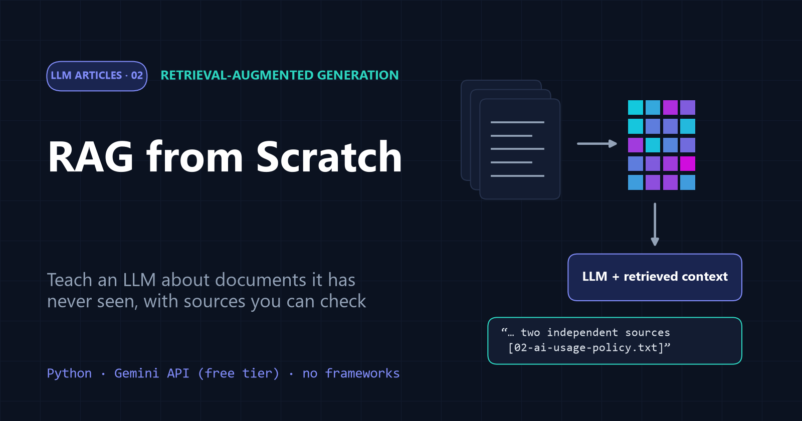

# 02 · RAG from Scratch

[](article.md)

A complete retrieval-augmented generation (RAG) assistant in about 100 lines of plain Python. It loads documents, splits them into chunks, embeds them, retrieves the relevant ones, and has Gemini answer with source citations, or refuse when the answer isn't in the documents.

| File | What it is |
| --- | --- |
| [article.md](article.md) | the full article |
| [rag.ipynb](rag.ipynb) | step-by-step notebook with explanations and real outputs |
| [rag.py](rag.py) | the same pipeline as a single script |
| [utils/](utils/) | the from-scratch RAG toolkit (see below) |
| [data/](data/) | the knowledge base: five documents from a **fictional** company |
| [assets/](assets/) | diagrams and charts used in the article |

## The toolkit in `utils/`

| Module | Pipeline step | Main class |
| --- | --- | --- |
| `text_utils.py` | load and split | `TextFileLoader`, `CharacterTextSplitter` |
| `embedding.py` | embed | `EmbeddingModel` (`gemini-embedding-001`, batched, retries on 429) |
| `vectordatabase.py` | store and retrieve | `VectorDatabase` (NumPy matrix + cosine similarity) |
| `prompts.py` | prompt | `SystemRolePrompt`, `UserRolePrompt` |
| `chatmodel.py` | generate | `ChatGemini` (default `gemini-3.5-flash-lite`) |

Each module has a small self-test. Run it from inside `02-RAG`, for example `python -m utils.vectordatabase`.

## About the data

The `data/` folder describes **Brightwave Labs, a fictional company** invented for this tutorial: its AI usage policy, its internal RAG assistant, its evaluation process and an employee FAQ. Because the company isn't real, no language model has seen these documents, so correct answers can only come from retrieval. All names, numbers and policies are made up.

## Run it

From the repository root (see the [main README](../README.md) for setup):

```bash
jupyter notebook 02-RAG/rag.ipynb
# or
python 02-RAG/rag.py
```

A full run makes 7 embedding requests and 6 chat requests. If a model's daily free quota runs out, set `GEMINI_CHAT_MODEL` in `.env` to another model, for example `gemini-3.1-flash-lite`.

**Previous:** [01 · Embeddings](../01-Embeddings/)
