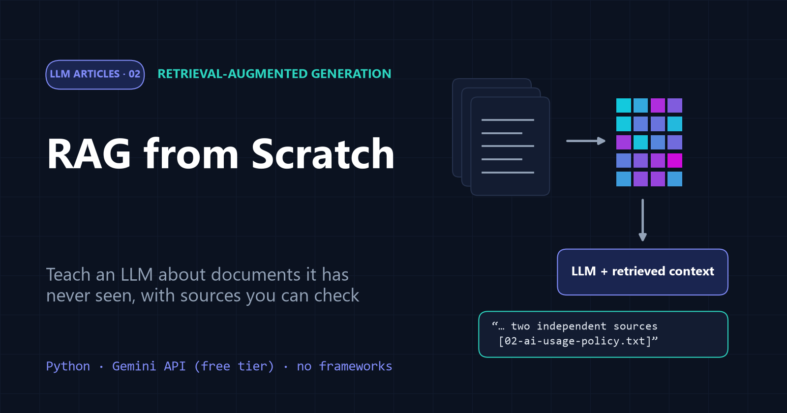
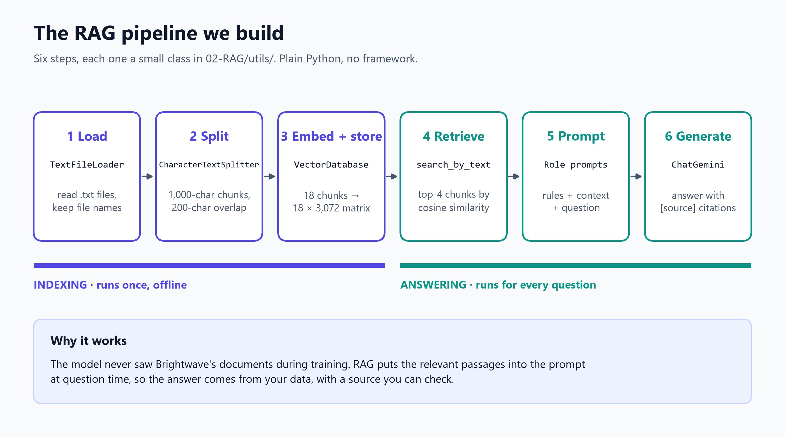
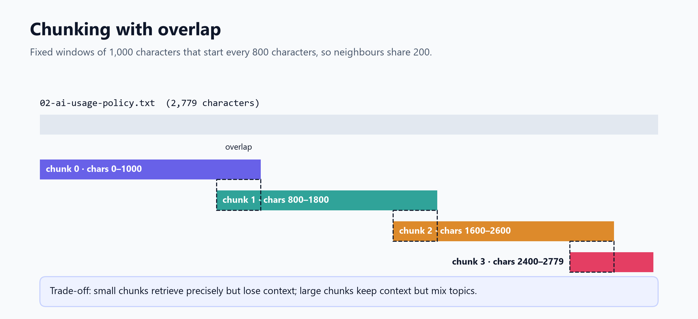
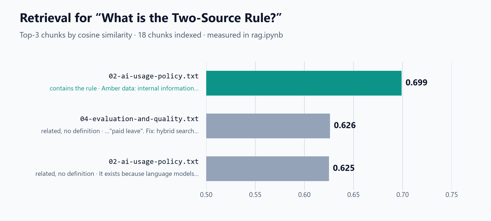
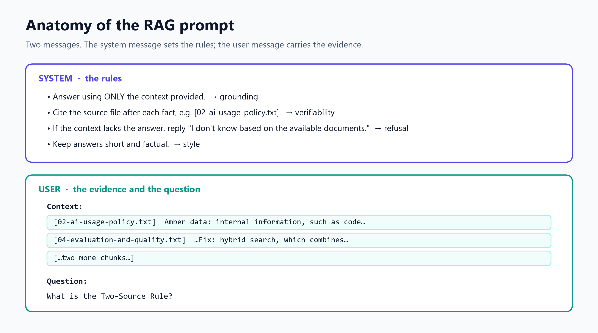
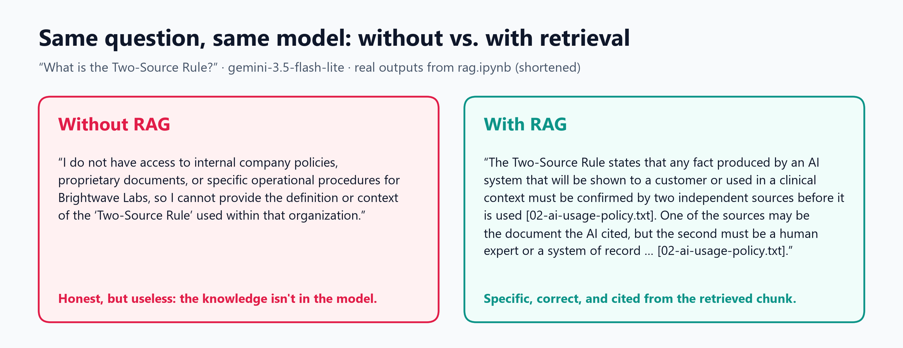
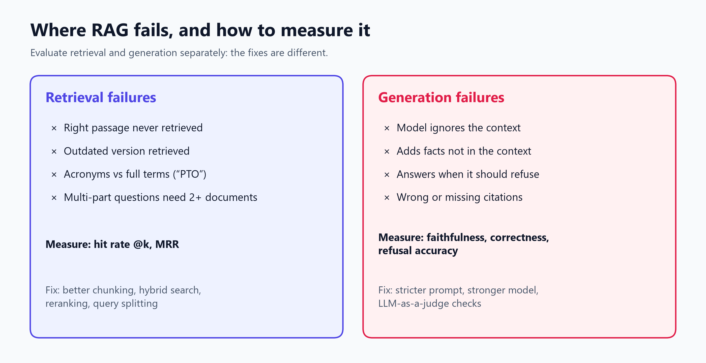

# RAG from Scratch: Teaching an LLM About Documents It Has Never Seen



*Part 2 of the [LLM Articles](../README.md) series · Code: [`rag.ipynb`](rag.ipynb) and [`utils/`](utils/) · Runs on the free tier of the Gemini API*

Ask a large language model (LLM) about your company's travel policy and one of two things happens. It politely admits it has no idea, or, worse, it invents a confident, plausible and completely wrong answer. LLMs know a great deal about the public internet up to their training date. They know nothing about your documents.

**Retrieval-augmented generation (RAG)** is the standard fix. Before the model answers, you **retrieve** the most relevant passages from your own documents and hand them to the model along with the question. The model then answers from that evidence, and it can tell you where each fact came from.

In this article we build a complete RAG system **from scratch**, in about 100 lines of plain Python with no framework, on the free tier of Google's Gemini API. Every step stays visible: load, split, embed, store, retrieve, prompt, generate. All outputs shown come from actually running the code.

[Part 1](../01-Embeddings/article.md) explained embeddings and dense vector search. RAG is what happens when you put that search engine in front of a language model.

**What you will learn**

- Why LLMs need retrieval, and when RAG beats fine-tuning or a giant context window
- How to load, chunk, embed and index documents
- How to write a prompt that keeps the model grounded, makes it cite sources and lets it refuse
- What a real run looks like, including what goes wrong
- Where RAG fails, how to measure it, and what to improve next

---

## Table of contents

1. [The problem: what an LLM doesn't know](#1-the-problem-what-an-llm-doesnt-know)
2. [What is RAG?](#2-what-is-rag)
3. [The knowledge base](#3-the-knowledge-base)
4. [Step 1 – Load](#4-step-1--load)
5. [Step 2 – Split into chunks](#5-step-2--split-into-chunks)
6. [Step 3 – Embed and store](#6-step-3--embed-and-store)
7. [Step 4 – Retrieve](#7-step-4--retrieve)
8. [Step 5 – Build the prompt](#8-step-5--build-the-prompt)
9. [Step 6 – Generate](#9-step-6--generate)
10. [Putting it all together](#10-putting-it-all-together)
11. [Where RAG fails, and how to measure it](#11-where-rag-fails-and-how-to-measure-it)
12. [Making it production-ready](#12-making-it-production-ready)
13. [Key takeaways](#13-key-takeaways)
14. [References](#references)

---

## 1. The problem: what an LLM doesn't know

A language model's knowledge is frozen at training time and limited to what it saw. That leaves three gaps:

- **Private data:** your wiki, contracts, tickets and policies were never in the training set.
- **Fresh data:** anything that changed after the training cut-off.
- **Verifiability:** even when the model knows something, it can't point to a source. When it doesn't know, it may **hallucinate**, that is, produce fluent text that is false.

Here is the model we use in this article, `gemini-3.5-flash-lite`, asked about our example company with no extra context (real output, from Step 5 of the notebook):

> *"I do not have access to internal company policies, proprietary documents, or specific operational procedures for Brightwave Labs, so I cannot provide the definition or context of the 'Two-Source Rule' used within that organization."*

That is an honest answer, and a useless one. When we first ran the same question on `gemini-3.5-flash`, it did something more dangerous. It acknowledged it didn't know the company, then confidently described two *generic* "two-source rules" from research and procurement, neither of which is Brightwave's. That is exactly the kind of answer that sounds right and isn't.

---

## 2. What is RAG?

**Retrieval-augmented generation** combines a retriever with a generator [1]:

1. **Retrieve:** find the passages most relevant to the question, usually with dense vector search over embeddings [8].
2. **Augment:** put those passages into the prompt as *context*.
3. **Generate:** let the LLM answer *from that context*, citing it.



The pipeline has two phases. **Indexing** (steps 1–3) prepares your documents once. **Answering** (steps 4–6) runs for every question.

### Why not fine-tune, or just paste everything in?

Modern models accept very long inputs. The models used here accept over a million tokens. So why retrieve at all?

| Approach | Strengths | Weaknesses |
| --- | --- | --- |
| **Fine-tuning** on your documents | teaches style, format and domain language | costly to repeat whenever documents change; can't cite sources; hard to *remove* a document |
| **Long context:** paste everything | simple; no index needed | cost and latency grow with every question; models can miss facts buried in the middle of long inputs [6]; doesn't scale past the window; no per-user access control |
| **RAG** | always up to date (re-index a file in seconds); cites sources; sends only what's needed; can filter by permission | quality depends on retrieval; more moving parts |

In practice these combine. Many systems fine-tune for tone, use RAG for facts, and use long context to fit more retrieved chunks. For "answer questions from our documents", RAG is the default starting point.

---

## 3. The knowledge base

To make RAG's effect easy to see, the `data/` folder contains five short documents from **Brightwave Labs, a fictional company** invented for this tutorial. Because it doesn't exist, no model has seen these documents, so any correct answer must come from retrieval.

| File | Content |
| --- | --- |
| `01-company-overview.txt` | what the company does, its AI features, teams, key numbers |
| `02-ai-usage-policy.txt` | data classes, the **Two-Source Rule**, vendor approval process |
| `03-atlas-architecture.txt` | how its internal RAG assistant "Atlas" is built |
| `04-evaluation-and-quality.txt` | how it measures answer quality |
| `05-employee-faq.txt` | vacation, remote work, budgets, onboarding |

The documents describe modern AI practice themselves: a model gateway, data classification, reranking, evaluation gates. So the demo doubles as a short tour of how companies run RAG in production.

---

## 4. Step 1 – Load

The loader reads every `.txt` file in a folder. Each piece of text keeps the **name of its source file**, which is what makes citations possible later.

```python
@dataclass
class Document:
    """A piece of text plus the name of the file it came from (used for citations)."""
    text: str
    source: str

class TextFileLoader:
    def __init__(self, path: str, encoding: str = "utf-8"):
        self.path = Path(path)
        self.encoding = encoding

    def load_documents(self) -> List[Document]:
        files = sorted(self.path.rglob("*.txt")) if self.path.is_dir() else [self.path]
        return [Document(f.read_text(encoding=self.encoding), f.name) for f in files]
```

```text
Loaded 5 documents:
  01-company-overview.txt           2286 characters
  02-ai-usage-policy.txt            2779 characters
  03-atlas-architecture.txt         2728 characters
  04-evaluation-and-quality.txt     2657 characters
  05-employee-faq.txt               2153 characters
```

(In the repository the loader also validates the path. It's trimmed here for readability.)

---

## 5. Step 2 – Split into chunks

Why not embed whole documents? A question about vacation days doesn't need the entire FAQ. A whole-document vector also *averages* many topics together and matches nothing precisely. So we cut documents into **chunks**.

Our splitter is deliberately simple: fixed windows of 1,000 characters that start every 800 characters. Neighbouring chunks therefore **overlap** by 200 characters, so a sentence that straddles a boundary still appears whole in at least one chunk.



```python
class CharacterTextSplitter:
    def __init__(self, chunk_size: int = 1000, chunk_overlap: int = 200):
        if chunk_size <= chunk_overlap:
            raise ValueError("chunk_size must be greater than chunk_overlap")
        self.chunk_size = chunk_size
        self.chunk_overlap = chunk_overlap

    def split(self, text: str) -> List[str]:
        step = self.chunk_size - self.chunk_overlap
        return [text[i : i + self.chunk_size] for i in range(0, len(text), step)]
```

The notebook confirms that the 5 documents become **18 chunks**, and that the last 200 characters of chunk 0 are exactly the first 200 of chunk 1. It also shows the weakness of counting characters: the shared text starts with `"de CareRoute…"`, cut in the middle of the word "inside". Production systems split on paragraphs, sentences or headings instead. The Brightwave architecture document describes its own team testing 300, 800 and 1,500-token chunks and picking 800.

**The chunk-size trade-off:** small chunks retrieve precisely but lose surrounding context. Large chunks keep context but mix topics, which dilutes their embeddings. Measure on your own questions; don't guess.

---

## 6. Step 3 – Embed and store

Each chunk becomes an embedding with `gemini-embedding-001` (see [Part 1](../01-Embeddings/article.md)). The vector store is just a NumPy matrix with one row per chunk:

```python
class EmbeddingModel:
    def get_embeddings(self, texts, task_type="RETRIEVAL_DOCUMENT") -> np.ndarray:
        vectors = []
        for start in range(0, len(texts), BATCH_SIZE):  # at most 100 texts per request
            response = self.client.models.embed_content(
                model=self.model_name,
                contents=texts[start : start + BATCH_SIZE],
                config=types.EmbedContentConfig(task_type=task_type),
            )
            vectors.extend(e.values for e in response.embeddings)
        return np.array(vectors)

class VectorDatabase:
    def build_from_documents(self, chunks):
        self.chunks = list(chunks)
        self.vectors = self.embedding_model.get_embeddings(
            [c.text for c in self.chunks], task_type="RETRIEVAL_DOCUMENT"
        )
        return self
```

```text
Vector matrix shape: (18, 3072) (chunks x dimensions)
```

Three design choices matter:

- **One batched request** embeds all 18 chunks. On the free tier, where limits are counted in requests, batching is the difference between a demo that works and one that hits rate limits.
- **`task_type`:** chunks are embedded as `RETRIEVAL_DOCUMENT` and questions as `RETRIEVAL_QUERY`, which tells the model to optimize for question-to-passage matching [2].
- **A model gotcha we found:** we also tried the newer `gemini-embedding-2`. When we sent it a *list* of texts, it returned **one** vector instead of one per text, apparently treating the list as a single multi-part input. Batching with it needs a different call pattern. `gemini-embedding-001` behaves as expected, so we use it. Whatever model you choose, always check that `len(vectors) == len(texts)`.

---

## 7. Step 4 – Retrieve

To answer a question, we embed it and rank every chunk by cosine similarity:

```python
def cosine_similarity(matrix, vector):
    return (matrix @ vector) / (np.linalg.norm(matrix, axis=1) * np.linalg.norm(vector))

def search_by_text(self, query: str, k: int = 4):
    query_vector = self.embedding_model.get_embedding(query, task_type="RETRIEVAL_QUERY")
    scores = cosine_similarity(self.vectors, query_vector)
    best = np.argsort(-scores)[:k]
    return [(self.chunks[i], float(scores[i])) for i in best]
```

For *"What is the Two-Source Rule?"*:



```text
0.699  [02-ai-usage-policy.txt]  defines the rule: yes | starts: Amber data: internal information...
0.626  [04-evaluation-and-quality.txt]  defines the rule: no
0.625  [02-ai-usage-policy.txt]  defines the rule: no
```

The right chunk wins clearly. Note two things:

- **It doesn't *start* with the answer.** The winning chunk opens with the data-classes section and contains the rule further down. Retrieval scores whole chunks, which is another reason chunk boundaries matter.
- **The runners-up are related but don't answer the question.** One discusses hallucinations, the reason the rule exists. Retrieval brings back *topically similar* text, not guaranteed answers. Handling that is the generator's job, guided by the prompt.

---

## 8. Step 5 – Build the prompt

The prompt is where retrieval meets generation. We use two messages:



```python
RAG_SYSTEM_TEMPLATE = """You are Atlas, an internal assistant for Brightwave Labs.
Answer the question using ONLY the context provided.
After each fact, cite its source file in square brackets, for example [02-ai-usage-policy.txt].
If the context does not contain the answer, reply exactly: "I don't know based on the available documents."
Keep answers short and factual."""

RAG_USER_TEMPLATE = """Context:
{context}

Question:
{question}"""
```

Each rule has a job:

| Rule | Purpose |
| --- | --- |
| "using ONLY the context" | **grounding:** stops the model from mixing in guesses from memory |
| "cite its source file" | **verifiability:** a reader can check every claim |
| "reply exactly: I don't know…" | **refusal:** gives the model a safe, specific way out instead of inventing an answer |
| "short and factual" | **style:** less text means fewer chances to drift from the evidence |

The templates are small `RolePrompt` objects that fill in `{placeholders}` and raise an error if a variable is missing. That's a tiny safeguard against silently sending an empty context.

---

## 9. Step 6 – Generate

`ChatGemini` turns our role-based messages into a Gemini request. Gemini takes system messages as a separate `system_instruction` and calls the assistant role `model`:

```python
class ChatGemini:
    def __init__(self, model_name=None, client=None):
        self.model_name = model_name or os.getenv("GEMINI_CHAT_MODEL", "gemini-3.5-flash-lite")
        self.client = client or get_client()

    def run(self, messages) -> str:
        system = "\n\n".join(m["content"] for m in messages if m["role"] == "system")
        contents = [
            types.Content(role="model" if m["role"] == "assistant" else "user",
                          parts=[types.Part.from_text(text=m["content"])])
            for m in messages if m["role"] != "system"
        ]
        response = self.client.models.generate_content(
            model=self.model_name,
            contents=contents,
            config=types.GenerateContentConfig(system_instruction=system or None),
        )
        return response.text
```

### Choosing a model on the free tier

We tested several Gemini models with the same free key:

- **`gemini-3.8-flash`** took about **85 seconds** for a one-sentence answer, which is too slow for an interactive demo.
- **`gemini-3.5-flash`** answered in about **4 seconds**. But during development we hit its free-tier limit of **20 requests per day** (the limit reported in the API's quota error), and once a daily limit is reached, retrying doesn't help.
- **`gemini-3.5-flash-lite`** answered in under a second, gave equally correct grounded answers on our questions, and has its own separate quota.

So the code defaults to Flash-Lite, and you can override it with the `GEMINI_CHAT_MODEL` environment variable. The client also retries automatically on temporary rate limits (HTTP 429). If a daily quota is exhausted, it raises a clear error that names the model and suggests switching. Free-tier limits are counted **per project and per model** [3]. Check yours in [AI Studio](https://aistudio.google.com/rate-limit). RAG answers come mostly from the context, which is why a small, fast model often does the job.

---

## 10. Putting it all together

The whole pipeline fits in one small class:

```python
class RAGPipeline:
    def __init__(self, llm, vector_db, k=4):
        self.llm, self.vector_db, self.k = llm, vector_db, k

    def run(self, question: str) -> dict:
        retrieved = self.vector_db.search_by_text(question, k=self.k)
        context = "\n\n".join(f"[{chunk.source}]\n{chunk.text}" for chunk, _ in retrieved)
        messages = [
            system_prompt.create_message(),
            user_prompt.create_message(context=context, question=question),
        ]
        return {"answer": self.llm.run(messages), "context": retrieved}
```

Each chunk is labelled with its file name inside the context, so the model has something concrete to cite. The method also returns the retrieved chunks, so you can always check an answer against its evidence.



### Results

Real answers from `gemini-3.5-flash-lite`, shortened slightly:

| Question | Answer | Verdict |
| --- | --- | --- |
| What is the Two-Source Rule? | "…any fact produced by an AI system that will be shown to a customer or used in a clinical context must be confirmed by two independent sources… [02-ai-usage-policy.txt]" | ✅ correct, cited |
| What chunk size does Atlas use, and why? | "…about 800 tokens (with an overlap of 120 tokens)… smaller chunks lost context and larger chunks mixed several topics together [03-atlas-architecture.txt]" | ✅ correct, includes the *why* |
| Who must approve a new AI model vendor, in what order? | "1. security review by the Security team 2. privacy review by the Data Protection Officer 3. final approval by the Responsible AI Council [02-ai-usage-policy.txt]" | ✅ correct order |
| How many vacation days do I get after four years? | "25 days… after three years you receive two extra days… after four years you receive 27 days" | ✅ combines two facts correctly |
| Who won the 2022 FIFA World Cup? | "I don't know based on the available documents." | ✅ correct refusal |

The last row matters most. The model certainly *knows* the answer to a famous football question, but our prompt told it to answer only from the documents, and it obeyed. In a real assistant, that discipline is what makes answers trustworthy.

---

## 11. Where RAG fails, and how to measure it

A RAG system can fail in two places, and the fixes are different:



**Retrieval failures:** the right passage never reaches the model.
- Measure with **hit rate @k** (how often at least one of the top *k* chunks contains the answer) and **mean reciprocal rank** (MRR, which rewards putting the right chunk near the top).

**Generation failures:** the right passage was retrieved, but the answer is still wrong.
- **Faithfulness:** is every claim in the answer supported by the context? An answer that adds a true fact *not* in the context still counts as unfaithful.
- **Correctness:** does the answer match a reference answer?
- **Refusal accuracy:** does it say "I don't know" when it should?

To measure these you need a **test set**: real questions with reference answers, including some the documents can't answer. Faithfulness and correctness are often scored automatically by a second LLM acting as a judge with a written rubric (*LLM-as-a-judge* [4]). Frameworks such as RAGAS [5] package these metrics. Spot-check the judge against human grades regularly; it can be wrong too.

The Brightwave evaluation document describes this setup: a 400-question "golden set", separate retrieval and generation metrics, and a rule that blocks any release which lowers a metric by more than 2 points. The company is fictional, but the process is real best practice.

---

## 12. Making it production-ready

Our ~100-line system is a faithful skeleton of production RAG. Here is what you'd add, roughly in order of impact:

1. **Smarter chunking:** split on paragraphs, headings or sentences, and attach metadata such as title, date and owner.
2. **Hybrid search:** combine embedding search with keyword search (BM25) [7], so acronyms, product codes and names match exactly.
3. **Reranking:** retrieve 20–50 candidates cheaply, then let a stronger cross-encoder or LLM pick the best 5.
4. **Query transformation:** rewrite vague questions, or split multi-part questions ("What's the travel budget and who approves it?") into sub-queries.
5. **Access control:** filter retrieved chunks by the user's permissions *before* they reach the model.
6. **A real vector index:** move from a NumPy matrix to an ANN index such as HNSW or FAISS once you have more than about 100,000 chunks.
7. **Agentic retrieval:** instead of always retrieving once, let the model call search as a *tool*, deciding when to search, what to search for, and whether to search again.
8. **Evaluation and monitoring:** a golden test set, the metrics from Section 11, and user feedback signals such as thumbs-up rates.

---

## 13. Key takeaways

- **LLMs don't know your documents.** RAG gives them the right passages at question time, without retraining.
- **RAG is a pipeline:** load → split → embed → store → retrieve → prompt → generate. Each step is simple, and the quality comes from getting each one right.
- **Chunking and retrieval set the ceiling.** If the right chunk isn't retrieved, no model can answer correctly.
- **The prompt enforces honesty:** answer only from context, cite sources, and refuse when the answer isn't there.
- **Measure retrieval and generation separately.** Use hit rate and MRR for retrieval; faithfulness, correctness and refusal accuracy for generation.
- **On a free tier, design for quotas.** Batch embedding requests, prefer fast lite models, and handle 429 errors clearly.

---

## How to run the code

```bash
git clone https://github.com/Ahmed-Manai/llm-articles.git
cd llm-articles
pip install -r requirements.txt
cp .env.example .env        # then paste your free key from https://aistudio.google.com/apikey
jupyter notebook 02-RAG/rag.ipynb     # or: python 02-RAG/rag.py
```

One full run of the notebook makes 7 embedding requests (1 to index all chunks, 6 for questions) and 6 chat requests, which fits comfortably in the free tier.

---

## References

1. Lewis, P., et al. (2020). *Retrieval-Augmented Generation for Knowledge-Intensive NLP Tasks.* arXiv:2005.11401. https://arxiv.org/abs/2005.11401
2. Google. *Embeddings* (Gemini API documentation). https://ai.google.dev/gemini-api/docs/embeddings
3. Google. *Gemini API rate limits.* https://ai.google.dev/gemini-api/docs/rate-limits
4. Zheng, L., et al. (2023). *Judging LLM-as-a-Judge with MT-Bench and Chatbot Arena.* arXiv:2306.05685. https://arxiv.org/abs/2306.05685
5. Es, S., James, J., Espinosa-Anke, L., & Schockaert, S. (2023). *RAGAS: Automated Evaluation of Retrieval Augmented Generation.* arXiv:2309.15217. https://arxiv.org/abs/2309.15217
6. Liu, N. F., et al. (2023). *Lost in the Middle: How Language Models Use Long Contexts.* arXiv:2307.03172. https://arxiv.org/abs/2307.03172
7. Robertson, S., & Zaragoza, H. (2009). *The Probabilistic Relevance Framework: BM25 and Beyond.* Foundations and Trends in Information Retrieval, 3(4).
8. Karpukhin, V., et al. (2020). *Dense Passage Retrieval for Open-Domain Question Answering.* arXiv:2004.04906. https://arxiv.org/abs/2004.04906

---

*About this article: every output shown comes from running [`rag.ipynb`](rag.ipynb) on the Gemini API free tier with `gemini-embedding-001` and `gemini-3.5-flash-lite`. LLM answers can vary slightly between runs. Brightwave Labs and all of its documents are fictional and were written for this tutorial. All diagrams are original.*
