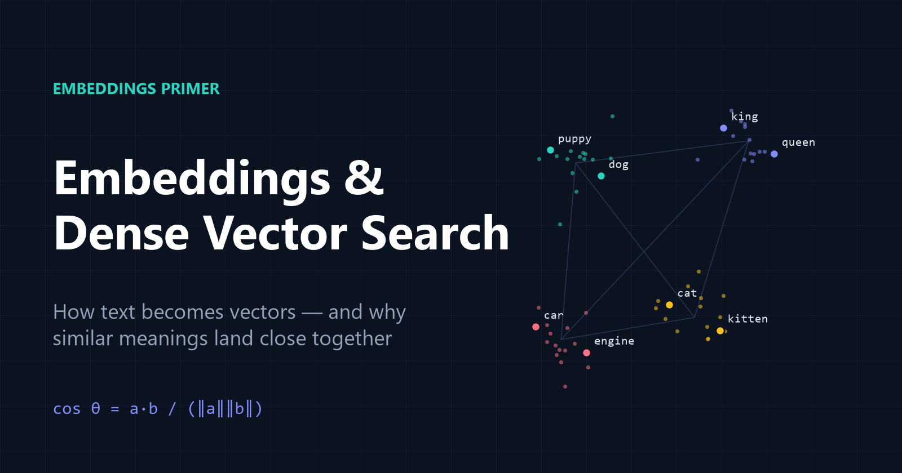

# Embeddings and Dense Vector Search: A Practical Primer

[](article.md)

A beginner-friendly, technically careful introduction to **embeddings**: how text becomes vectors, how cosine similarity measures meaning, and how those pieces combine into **dense vector search** and retrieval-augmented generation (RAG).

**👉 [Read the full article](article.md)**

## What's inside

- Why one-hot encoding fails and dense embeddings succeed
- A toy geometric model of how embeddings capture relationships
- Cosine similarity: the formula, a NumPy implementation, and how to read scores correctly
- Real results from OpenAI's `text-embedding-3-small`, with notes on experimental design
- A critical look at *king − man + woman ≈ queen*
- A minimal semantic search engine in about 15 lines of Python, plus how it scales (HNSW, FAISS) and feeds RAG
- Practical applications, limitations, and 13 references

## Key takeaways

1. **Embeddings turn data into dense vectors where geometry encodes meaning.** Similar inputs land close together, and relationships become approximate directions.
2. **Cosine similarity compares direction (−1 to 1).** For unit-length embeddings, such as OpenAI's, it equals the dot product.
3. **Read scores relatively.** There is no universal threshold, and −1 does not mean "opposite meaning".
4. **Dense vector search** means embedding your documents once, embedding each query, and ranking by similarity. This is the retrieval half of RAG.

## Repository contents

```
.
├── README.md      ← you are here
├── article.md     ← the full article
└── assets/        ← diagrams used in the article
    ├── cover.png
    ├── sparse-vs-dense.png
    ├── semantic-space.png
    ├── cosine-similarity.png
    ├── notebook-results.png
    ├── vector-arithmetic.png
    └── dense-search-pipeline.png
```

## Running the code

The article's examples need Python 3.9+, `numpy`, and `openai`. The API examples need an `OPENAI_API_KEY` environment variable. See [Section 4 of the article](article.md#4-hands-on-comparing-sentences-with-openai-embeddings).
