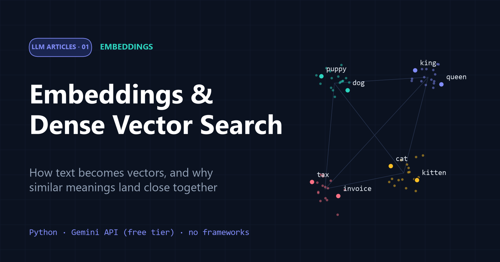
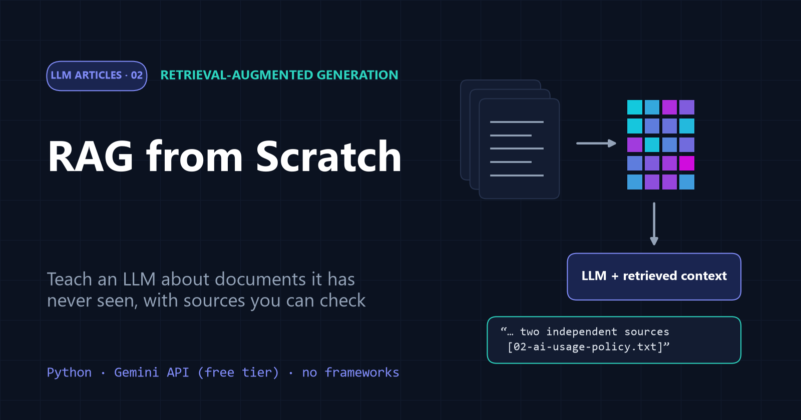

# LLM Articles

Hands-on articles about how large language model (LLM) applications work, built from first principles. Each topic has a long-form article, a notebook that explains and runs the code, and a plain Python script.

Everything runs on the **free tier of the Gemini API** with plain Python, without frameworks, so every step stays visible.

## Topics

| # | Topic | Article | Notebook | Script | You will build |
| --- | --- | --- | --- | --- | --- |
| 01 | **Embeddings** | [Embeddings and Dense Vector Search](01-Embeddings/article.md) | [embeddings.ipynb](01-Embeddings/embeddings.ipynb) | [embeddings.py](01-Embeddings/embeddings.py) | cosine similarity, sentence comparisons, a tiny semantic search engine |
| 02 | **RAG** | [RAG from Scratch](02-RAG/article.md) | [rag.ipynb](02-RAG/rag.ipynb) | [rag.py](02-RAG/rag.py) | a complete retrieval-augmented Q&A assistant with cited answers |

The topics build on each other: Part 2 uses the embeddings and vector search from Part 1.

[](01-Embeddings/article.md)
[](02-RAG/article.md)

## Quick start

```bash
git clone https://github.com/Ahmed-Manai/llm-articles.git
cd llm-articles
pip install -r requirements.txt
cp .env.example .env          # paste your free key from https://aistudio.google.com/apikey
jupyter notebook              # open any topic's notebook
```

Or run a script directly from the repository root: `python 01-Embeddings/embeddings.py`.

**Free tier notes:** limits are counted per project and per model, and you can see yours at <https://aistudio.google.com/rate-limit>. The code batches requests, retries automatically on temporary rate limits, and defaults to fast models with roomy quotas. You can override the models in `.env` with `GEMINI_CHAT_MODEL` and `GEMINI_EMBEDDING_MODEL`.

## Repository layout

```
llm-articles/
├── README.md            ← this index
├── requirements.txt     ← shared Python dependencies
├── .env.example         ← copy to .env and add your key (.env is git-ignored)
├── 01-Embeddings/
│   ├── README.md
│   ├── article.md       ← the article
│   ├── embeddings.ipynb ← explanations + runnable code + real outputs
│   ├── embeddings.py    ← the same code as a script
│   └── assets/          ← images used by the article
└── 02-RAG/
    ├── README.md
    ├── article.md
    ├── rag.ipynb
    ├── rag.py
    ├── utils/           ← the from-scratch RAG toolkit (loader, splitter, embeddings, vector DB, prompts, chat)
    ├── data/            ← fictional knowledge base used in the demo
    └── assets/
```

## Adding a new topic

Every topic follows the same pattern, so the series stays easy to navigate:

1. Create a folder named `NN-Topic` with the next number, for example `03-Agents`.
2. Inside it, add `README.md`, `article.md`, `<topic>.ipynb`, `<topic>.py` and an `assets/` folder for images. Add `data/` or `utils/` only if the topic needs them.
3. Keep the topic self-contained: it should run from its own folder with the shared `requirements.txt` and the root `.env`.
4. Add a row to the **Topics** table above.

## License

No license has been chosen yet. Until one is added, all rights are reserved by the author.
