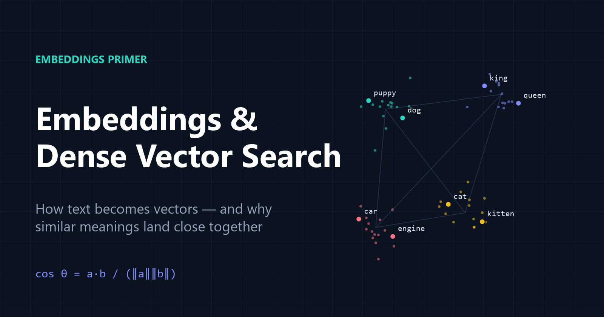
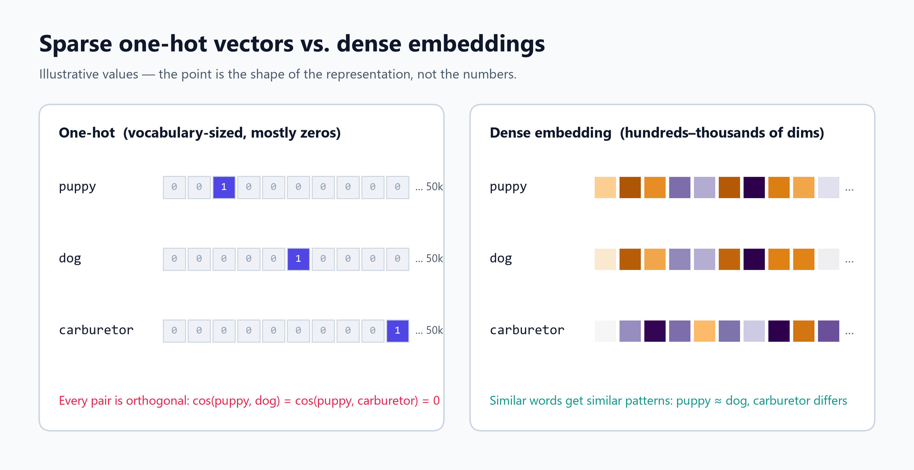
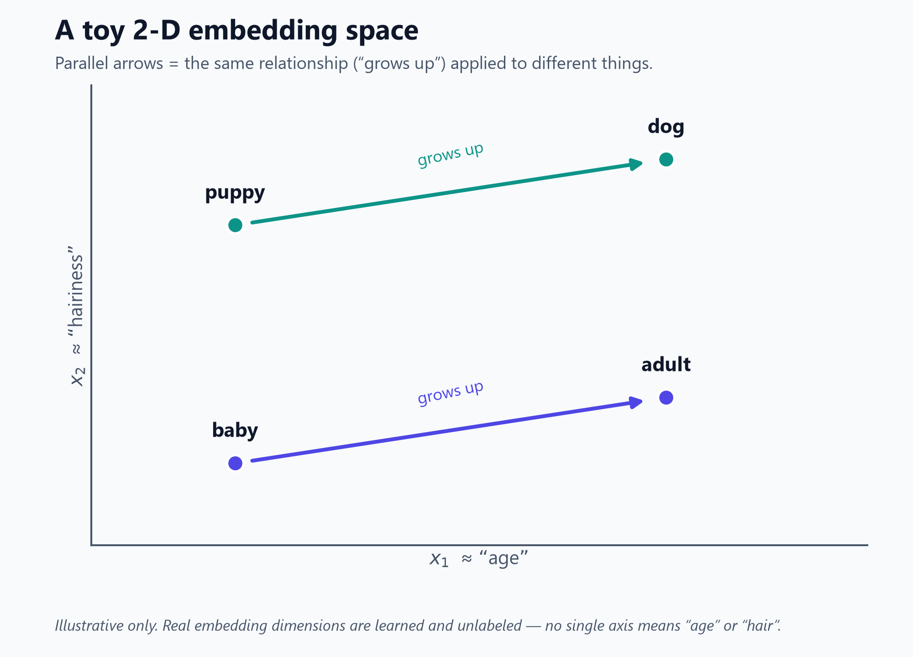
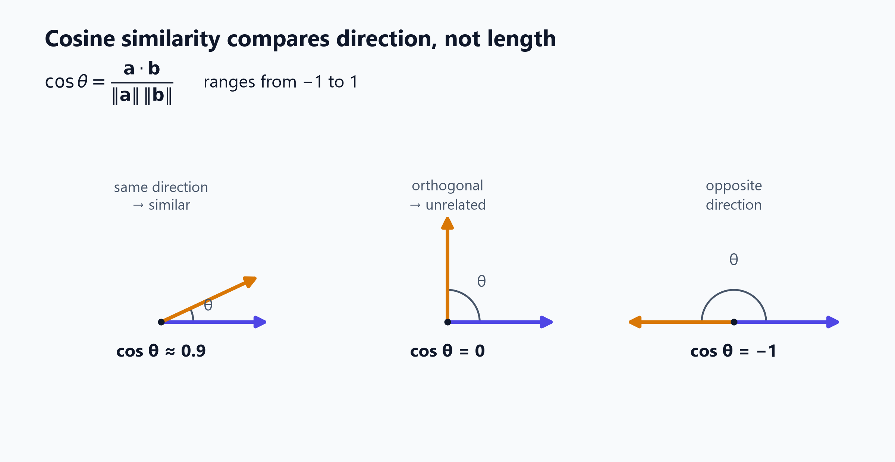
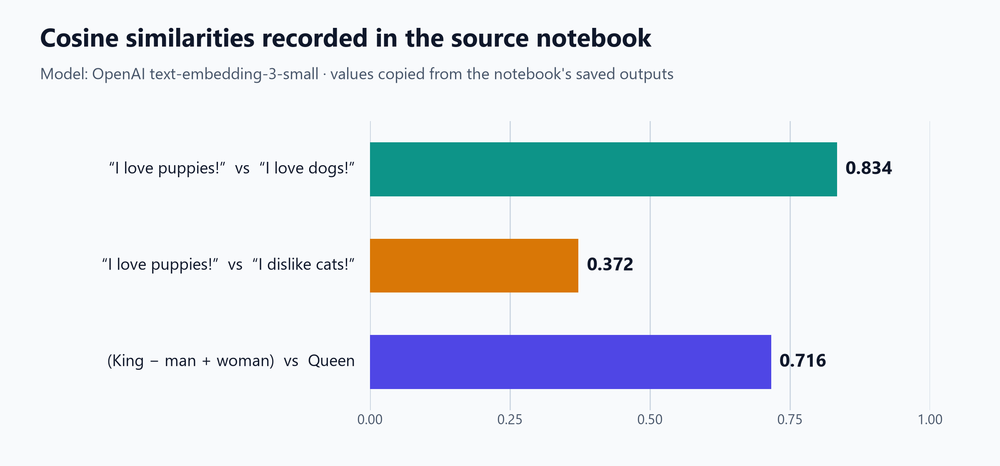
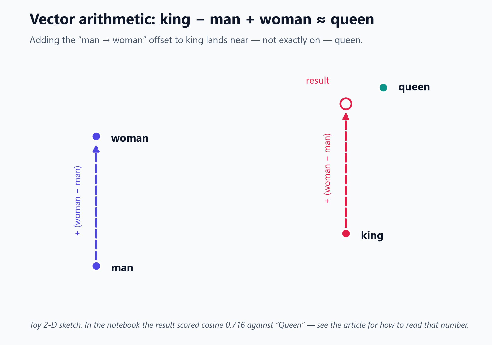
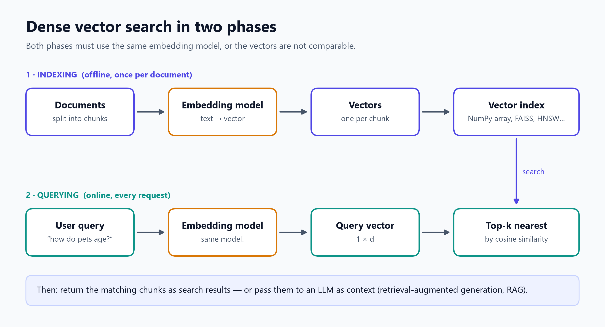

# Embeddings and Dense Vector Search: A Practical Primer



If you come from an NLP background, embeddings are probably old friends. If not, the topic can feel a bit… *dense*. (That joke makes more sense by the end of the article.)

Embeddings are the quiet workhorse behind semantic search, recommendation systems, clustering, and retrieval-augmented generation (RAG). They turn text, and also images, audio, and other data, into lists of numbers in which **distance tracks meaning**.

This primer builds the idea from first principles, implements the core math in a few lines of NumPy, walks through real results from OpenAI's `text-embedding-3-small` model, and ends with a working pattern for **dense vector search**. Along the way, it points out where the popular intuitions about embeddings are right and where they mislead.

**What you will learn**

- Why machine learning needs embeddings, and why simple one-hot encoding is not enough
- What an embedding is, and how it captures semantic relationships
- How cosine similarity measures "closeness", and how to read its scores correctly
- What the famous *king − man + woman ≈ queen* example does and does not prove
- How to build a minimal semantic search engine, and how it scales to RAG

**Prerequisites:** basic Python. NumPy helps but is not required. To run the API examples you need an OpenAI API key.

---

## Table of contents

1. [Why do we need embeddings?](#1-why-do-we-need-embeddings)
2. [What is an embedding?](#2-what-is-an-embedding)
3. [Measuring closeness with cosine similarity](#3-measuring-closeness-with-cosine-similarity)
4. [Hands-on: comparing sentences with OpenAI embeddings](#4-hands-on-comparing-sentences-with-openai-embeddings)
5. [Vector arithmetic: king − man + woman ≈ queen](#5-vector-arithmetic-king--man--woman--queen)
6. [From similarity to dense vector search](#6-from-similarity-to-dense-vector-search)
7. [Where embeddings are used](#7-where-embeddings-are-used)
8. [Limitations and pitfalls](#8-limitations-and-pitfalls)
9. [Key takeaways](#9-key-takeaways)
10. [References](#references)

---

## 1. Why do we need embeddings?

Machine learning models, from a small logistic regression to a large language model, share one requirement: **their inputs must be numbers**. People communicate in language, images, and sound, so we need a translation step from our world into the machine's.

A useful translation has to do two jobs:

1. **Convert non-numeric data into numeric data.**
2. **Preserve semantic relationships**, so that related inputs end up with related numbers and an algorithm can tell that *puppy* and *dog* have something in common.

### The naive approach: one-hot vectors

The simplest way to turn words into numbers is **one-hot encoding**. Give every word in the vocabulary its own position in a vector, set that position to `1`, and set everything else to `0`. With a 50,000-word vocabulary, every word becomes a 50,000-dimensional vector containing a single `1`.

This solves job 1, and fails job 2 completely:

- **Every pair of words is equally unrelated.** Any two one-hot vectors are *orthogonal* (at right angles), so *puppy* is exactly as similar to *dog* as it is to *carburetor*.
- **The vectors are huge and almost entirely zeros.** Vectors like this are called *sparse*.



**Embeddings** fix both problems. They are *dense* vectors (most entries are non-zero) with far fewer dimensions, typically hundreds to a few thousand. Their values are learned so that similar inputs get similar vectors. That is where the "dense" in *dense vector search* comes from, and why the opening joke was, regrettably, intentional.

---

## 2. What is an embedding?

> **Embedding:** a learned mapping from an input (a word, sentence, document, image…) to a fixed-length vector of real numbers, arranged so that inputs with similar meaning map to nearby points in the vector space.

You can think of each dimension as a *latent feature*: a hidden property of the data that the model discovered during training. A classic toy example makes this concrete. Imagine an embedding space with only two dimensions, where $x_1$ loosely tracks "age" and $x_2$ loosely tracks "hairiness":



- *puppy → dog* and *baby → adult* point in the **same direction**. Both are the relationship "grows up".
- Dogs are generally hairier than humans, so the dog/puppy pair sits higher on $x_2$.
- Adults usually have more hair than babies, so *adult* sits slightly higher than *baby*, shifted a little toward the dogs.

The key idea is that **relationships become directions**. Moving along the same direction from different starting points applies the same conceptual change.

This picture is a deliberate simplification. Real embedding dimensions are **not** labeled or individually interpretable. No single axis means "age" or "hair". Meaning is spread across many dimensions at once, and `text-embedding-3-small` returns 1,536 of them by default [1]. The toy model is still the right *mental model* of how geometry encodes semantics.

### Where do embeddings come from?

Embeddings are learned from data, mostly on the basis of the **distributional hypothesis**: words that appear in similar contexts tend to have similar meanings.

- **Word embeddings** such as word2vec [3] learn one vector per word by training a shallow network to predict a word's neighbors in large text corpora.
- **Sentence and document embeddings**, such as Sentence-BERT [5] and modern API models like OpenAI's `text-embedding-3` family, use transformer encoders. They are often trained *contrastively*, which means pulling matching pairs (a question and its answer, say) together in vector space and pushing non-matching pairs apart.

The examples below use a sentence-level model. It embeds a single word like "King" without trouble, but it was built to represent passages of text. That matters when we get to vector arithmetic.

---

## 3. Measuring closeness with cosine similarity

If similar meanings map to nearby vectors, we need a way to measure "nearby". The standard choice for embeddings is **cosine similarity**: the cosine of the angle $\theta$ between two vectors.

$$
\cos\theta = \frac{\mathbf{a} \cdot \mathbf{b}}{\lVert \mathbf{a} \rVert \, \lVert \mathbf{b} \rVert}
$$

Here, $\mathbf{a} \cdot \mathbf{b}$ is the **dot product** (multiply matching entries and sum them), and $\lVert \mathbf{a} \rVert$ is the vector's **length** (its Euclidean norm). Dividing by the lengths means cosine similarity only cares about **direction**, not magnitude.



The score ranges from **−1 to 1**:

| Score | Geometric meaning |
| --- | --- |
| `1` | Vectors point in exactly the same direction |
| `0` | Vectors are orthogonal (no shared direction) |
| `−1` | Vectors point in exactly opposite directions |

### Implementation

In NumPy this is a one-liner:

```python
import numpy as np
from numpy.linalg import norm

def cosine_similarity(vec_1, vec_2):
    """Cosine of the angle between two vectors, in [-1, 1]."""
    return np.dot(vec_1, vec_2) / (norm(vec_1) * norm(vec_2))
```

A quick sanity check on toy 3-D vectors (these outputs come from actually running the function):

```python
a = [1, 2, 3]
cosine_similarity(a, [2, 4, 6])     # 1.0     same direction (just longer)
cosine_similarity(a, [3, 0, -1])    # 0.0     orthogonal
cosine_similarity(a, [-1, -2, -3])  # -1.0    opposite direction
cosine_similarity(a, [3, 2, 1])     # 0.7143  partially aligned
```

Note that `[2, 4, 6]` scores a perfect `1.0` even though it is twice as long as `a`. Cosine similarity ignores length.

### Reading the scores correctly

Two common misconceptions are worth correcting early.

**1. "−1 means opposite in meaning." It doesn't.** A score of −1 is a statement about geometry, not semantics. Antonyms such as *love* and *hate* appear in very similar contexts ("I ___ this movie"), so embedding models usually place them **close together**, not at opposite poles. With modern text embedding models, scores between natural-language inputs also tend to fall in a narrower, mostly positive band rather than spreading across the full range from −1 to 1. This is a known geometric property of learned embedding spaces, sometimes called *anisotropy* [7].

**2. "Above 0.8 means similar." There is no universal threshold.** Score distributions differ between models. Use scores **relatively**: rank candidates, or compare against a baseline. If you need a cutoff, calibrate it on your own labeled data.

### A shortcut for normalized embeddings

OpenAI's embeddings are normalized to length 1 [2]. When $\lVert \mathbf{a} \rVert = \lVert \mathbf{b} \rVert = 1$, the denominator is 1, so **cosine similarity equals the plain dot product**. Ranking by cosine similarity, by dot product, or by Euclidean distance then gives identical orderings [2]. Vector databases exploit this to speed up search.

This only holds for unit-length vectors. As soon as you add or subtract embeddings (as in Section 5), the result is no longer unit length, so use the full formula.

---

## 4. Hands-on: comparing sentences with OpenAI embeddings

Let's embed real sentences. The original notebook called the API through a course helper library (`aimakerspace.openai_utils.embedding.EmbeddingModel`). To keep this article self-contained, the code below uses the official `openai` Python SDK directly.

### Setup

```bash
pip install openai numpy
```

Set your key as an environment variable instead of pasting it into code:

```bash
export OPENAI_API_KEY="sk-..."        # macOS / Linux
# setx OPENAI_API_KEY "sk-..."        # Windows (new terminals pick it up)
```

### An embedding helper

```python
import numpy as np
from openai import OpenAI

client = OpenAI()  # reads OPENAI_API_KEY from the environment
MODEL = "text-embedding-3-small"

def embed(texts: list[str]) -> np.ndarray:
    """Return one embedding per input text, as a (len(texts), dim) array."""
    response = client.embeddings.create(model=MODEL, input=texts)
    return np.array([item.embedding for item in response.data])
```

Sending a list embeds several texts in a single request, which is faster and cheaper than one call per text.

### Comparing two pairs of sentences

```python
puppy, dog, cat = embed(["I love puppies!", "I love dogs!", "I dislike cats!"])

print(cosine_similarity(puppy, dog))  # notebook result: 0.834
print(cosine_similarity(puppy, cat))  # notebook result: 0.372
```

The scores below are the ones recorded in the source notebook's saved outputs. If you rerun the code you may see small differences in later decimal places.



| Sentence A | Sentence B | Cosine similarity |
| --- | --- | --- |
| "I love puppies!" | "I love dogs!" | **0.834** |
| "I love puppies!" | "I dislike cats!" | **0.372** |

The first pair shares sentiment, structure, and a closely related subject, and it scores much higher. That matches intuition.

**A note on experimental design.** The second pair differs from the first in *two* ways at once: the sentiment (*love* → *dislike*) **and** the animal (*puppies* → *cats*). From these two numbers alone we can't tell how much of the drop comes from each change. To separate them, change one variable at a time:

```python
pairs = [
    ("I love puppies!", "I love cats!"),        # animal changes, sentiment fixed
    ("I love puppies!", "I dislike puppies!"),  # sentiment changes, animal fixed
]
for a, b in pairs:
    va, vb = embed([a, b])
    print(f"{cosine_similarity(va, vb):.3f}  {a!r} vs {b!r}")
```

This kind of controlled comparison is a good habit whenever you evaluate an embedding model on your own data.

---

## 5. Vector arithmetic: king − man + woman ≈ queen

The most famous demonstration that embeddings encode relationships is **vector arithmetic**. If the direction from *man* to *woman* captures a gender relationship, then adding that same direction to *king* should land near *queen*:

$$
\vec{\text{king}} - \vec{\text{man}} + \vec{\text{woman}} \approx \vec{\text{queen}}
$$



The notebook ran exactly this with `text-embedding-3-small`:

```python
king, man, woman, queen = embed(["King", "man", "woman", "Queen"])

result = king - man + woman
print(cosine_similarity(result, queen))  # notebook result: 0.716
```

The result vector scored **0.716** against "Queen". The arithmetic does not land exactly on *queen* because real models don't encode concepts like gender along clean, single directions. The relationship is spread across many dimensions and mixed with everything else the model learned.

### How to read that 0.716

A single similarity score can't tell you whether the arithmetic *did* anything. Before you call this a success, run two checks:

1. **Compare against a baseline.** *King* and *Queen* are already closely related (royalty, chess, playing cards). If `cosine_similarity(king, queen)` is itself around 0.7, the subtraction and addition added little. The analogy is convincing only if the result is clearly closer to *queen* than *king* was.
2. **Check that *queen* is the nearest candidate.** The classic word2vec evaluation [3][4] searches the whole vocabulary for the vector closest to the result. It also *excludes the input words*, because the result often stays nearest to *king* itself. Later work has shown that this exclusion step, and the cherry-picking of examples, can make analogies look more reliable than they are [8].

Both checks fit in a few lines:

```python
print("result vs queen:", cosine_similarity(result, queen))
print("king   vs queen:", cosine_similarity(king, queen))  # baseline

candidates = ["Queen", "Princess", "Woman", "King", "Duchess", "Banana"]
for word, vec in zip(candidates, embed(candidates)):
    print(f"{cosine_similarity(result, vec):.3f}  {word}")
```

These outputs are not reproduced here because the source notebook did not measure them. Running the snippet is the honest way to judge the analogy for this model.

Even so, the exercise teaches something real: **relationships correspond to approximate directions in embedding space**. That property is what makes embeddings useful far beyond word puzzles.

---

## 6. From similarity to dense vector search

The notebook's original motivation was practical: using embeddings to **choose relevant context**. That is **dense vector search** (also called *semantic search* or *dense retrieval*). Instead of matching keywords, you find the stored items whose embeddings are most similar to the query's embedding.



It works in two phases:

1. **Indexing (offline).** Split your documents into chunks (paragraphs or sections), embed each chunk once, and store the vectors.
2. **Querying (online).** Embed the user's query **with the same model**, compute its similarity to every stored vector, and return the top-*k* matches.

### A minimal semantic search engine

```python
documents = [
    "Puppies need several small meals a day while they grow.",
    "Adult dogs are usually fed once or twice daily.",
    "Kittens sleep up to 20 hours a day.",
    "A carburetor mixes air and fuel for an internal combustion engine.",
    "The queen is the most powerful piece in chess.",
]

doc_vectors = embed(documents)  # shape: (5, 1536) - computed once

def search(query: str, k: int = 3) -> list[tuple[float, str]]:
    query_vector = embed([query])[0]
    scores = doc_vectors @ query_vector  # dot product == cosine (unit-length vectors)
    top = np.argsort(-scores)[:k]
    return [(float(scores[i]), documents[i]) for i in top]

for score, doc in search("How often should I feed my young dog?"):
    print(f"{score:.3f}  {doc}")
```

Look at what this query has to deal with. It shares almost no keywords with the best answer: "feed" vs. "meals", and "young dog" vs. "puppies". Keyword matching struggles with that kind of gap, and embedding similarity is designed to bridge it. Run the snippet to see the ranking for yourself. The exact scores depend on the model, so none are shown here.

### Scaling up

The brute-force search above compares the query with every vector. That is fine for thousands of chunks, but it becomes slow at millions. Production systems use **approximate nearest neighbor (ANN)** indexes, which trade a small amount of recall for large speed-ups:

- **HNSW** (Hierarchical Navigable Small World graphs) [10] is used by many vector databases.
- **FAISS** [11] is a widely used library from Meta for efficient similarity search, with GPU support.

Vector databases package these indexes together with storage, filtering, and updates.

### Dense vs. sparse retrieval

Classic keyword search (TF-IDF, BM25) is **sparse retrieval**: documents are represented as vocabulary-sized vectors that are mostly zeros, like the one-hot vectors in Section 1. Dense retrieval finds paraphrases and synonyms that keyword search misses. Sparse retrieval still wins on exact terms such as product codes, names, or rare jargon. Many production systems run **hybrid search**, combining both scores.

### Embeddings in RAG

In **retrieval-augmented generation (RAG)** [9], the top-*k* chunks from dense vector search are inserted into a large language model's prompt as context. The model then answers from your documents rather than from its training data alone. Retrieval quality sets an upper bound on answer quality: if the right chunk is never retrieved, the LLM never sees it. That makes embedding choice and chunking two of the most important design decisions in a RAG system. Dense passage retrieval [6] was an influential early demonstration that learned dense vectors can outperform BM25 for open-domain question answering.

---

## 7. Where embeddings are used

The notebook focuses on language, but embeddings work for **any data a model can learn to represent**:

- **Semantic search and question answering:** find passages by meaning, not keywords.
- **RAG:** supply relevant context to LLMs.
- **Recommendations:** suggest items whose embeddings are near the ones a user engaged with.
- **Clustering and topic discovery:** group support tickets, reviews, or papers by theme.
- **Deduplication:** detect near-duplicate documents or questions.
- **Classification:** use embeddings as input features for a lightweight classifier.
- **Anomaly detection:** flag items far from every known cluster.
- **Multimodal search:** models such as CLIP embed images and text into a shared space, so you can search photos with a sentence.

---

## 8. Limitations and pitfalls

- **Similarity is not truth or relevance.** Embeddings capture *topical* similarity. "The drug is safe for children" and "The drug is not safe for children" can score very high against each other. Negation, numbers, and fine-grained logic are weak spots.
- **Dimensions are not interpretable.** You can't read off what a single dimension means, which makes failures harder to debug.
- **Vectors from different models are incompatible.** A vector from one model means nothing in another model's space. If you switch models, re-embed the entire corpus.
- **Benchmarks are a starting point.** Leaderboards such as MTEB [12] compare models across many tasks, but performance on *your* domain (legal, medical, code, non-English) can differ. Evaluate on a sample of real queries.
- **Input length is limited.** Models have a maximum input length, and one vector for a very long text blurs its details. Chunking strategy matters.
- **Learned bias.** Embeddings absorb associations from their training data, including social stereotypes [13]. Audit for this before using them in sensitive decisions.
- **Operational cost and privacy.** API-based embeddings cost money per token, add latency, and send your data to a third party. Self-hosted open models are an alternative when that matters.

---

## 9. Key takeaways

- **Embeddings turn data into dense vectors where geometry encodes meaning.** Similar inputs land near each other, and relationships become approximate directions.
- **Cosine similarity measures direction, from −1 to 1.** For unit-length embeddings like OpenAI's, it equals the dot product.
- **Read scores relatively.** There is no universal "similar" threshold, and −1 does not mean "opposite meaning". Antonyms often score high.
- **Design comparisons carefully.** Change one variable at a time, and use baselines when judging analogies like *king − man + woman ≈ queen*.
- **Dense vector search is "embed everything, embed the query, rank by similarity".** It powers semantic search and RAG, and it scales with ANN indexes such as HNSW and FAISS.

---

## References

1. OpenAI. *Vector embeddings* (guide). https://platform.openai.com/docs/guides/embeddings
2. OpenAI Help Center. *Embeddings FAQ*: embeddings are normalized to length 1; cosine similarity, dot product and Euclidean distance give identical rankings. https://help.openai.com/en/articles/6824809-embeddings-faq
3. Mikolov, T., Chen, K., Corrado, G., & Dean, J. (2013). *Efficient Estimation of Word Representations in Vector Space.* arXiv:1301.3781. https://arxiv.org/abs/1301.3781
4. Mikolov, T., Yih, W., & Zweig, G. (2013). *Linguistic Regularities in Continuous Space Word Representations.* NAACL-HLT. https://aclanthology.org/N13-1090/
5. Reimers, N., & Gurevych, I. (2019). *Sentence-BERT: Sentence Embeddings using Siamese BERT-Networks.* arXiv:1908.10084. https://arxiv.org/abs/1908.10084
6. Karpukhin, V., et al. (2020). *Dense Passage Retrieval for Open-Domain Question Answering.* arXiv:2004.04906. https://arxiv.org/abs/2004.04906
7. Ethayarajh, K. (2019). *How Contextual are Contextualized Word Representations?* arXiv:1909.00512. https://arxiv.org/abs/1909.00512
8. Nissim, M., van Noord, R., & van der Goot, R. (2020). *Fair Is Better than Sensational: Man Is to Doctor as Woman Is to Doctor.* Computational Linguistics, 46(2). arXiv:1905.09866. https://arxiv.org/abs/1905.09866
9. Lewis, P., et al. (2020). *Retrieval-Augmented Generation for Knowledge-Intensive NLP Tasks.* arXiv:2005.11401. https://arxiv.org/abs/2005.11401
10. Malkov, Y. A., & Yashunin, D. A. (2016). *Efficient and Robust Approximate Nearest Neighbor Search Using Hierarchical Navigable Small World Graphs.* arXiv:1603.09320. https://arxiv.org/abs/1603.09320
11. Johnson, J., Douze, M., & Jégou, H. (2017). *Billion-scale Similarity Search with GPUs* (FAISS). arXiv:1702.08734. https://arxiv.org/abs/1702.08734
12. Muennighoff, N., Tazi, N., Magne, L., & Reimers, N. (2022). *MTEB: Massive Text Embedding Benchmark.* arXiv:2210.07316. https://arxiv.org/abs/2210.07316
13. Bolukbasi, T., et al. (2016). *Man is to Computer Programmer as Woman is to Homemaker? Debiasing Word Embeddings.* arXiv:1607.06520. https://arxiv.org/abs/1607.06520

---

*About this article: it is adapted and extended from a Jupyter notebook primer on embeddings. The similarity scores in Sections 4 and 5 are reproduced from that notebook's saved outputs. The toy-vector outputs in Section 3 were produced by running the code shown. All diagrams are original illustrations made for this article.*
